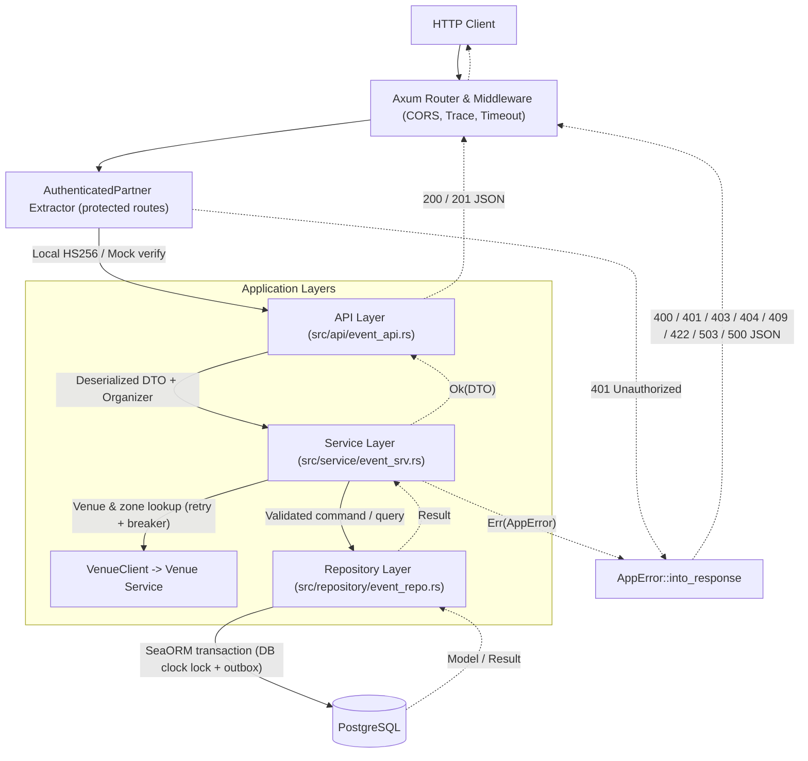

# System Architecture — Event Management API

## Overview

The **Event Management Microservice** owns the `EventManagement` sub-domain of Dsaster: creating and editing events, snapshotting venue zone prices, defining sales windows, scheduling events, enforcing the sale-open edit lock, and propagating public events to downstream services.

It follows a strict **Layered Architecture** where each layer only depends on traits/abstractions in the layer below it.

### Core Stack

- **Rust (edition 2024)** & **Tokio** async runtime
- **Axum 0.7** for HTTP routing, extractors, and error responses
- **Tower / tower-http** for HTTP middleware (CORS, tracing, timeouts)
- **SeaORM 1.0** on **PostgreSQL** (`sqlx-postgres`, `runtime-tokio-rustls`) with startup migrations
- **reqwest** for outbound HTTP calls to Venue Management Service
- **utoipa & utoipa-swagger-ui** for code-generated OpenAPI 3.0 (`openapi.yml` and `/swagger-ui`)

---

## Related Documentation

This document explains the service's code structure and runtime architecture. For product capabilities, contracts, and architectural decisions, see:

- **Capabilities & Design (C1–C6):** [capabilities-and-design-event-propagation.md](../event-propagation/capabilities-and-design-event-propagation.md)
- **Target Service Contract (HTTP & Kafka):** [contract-event-service.md](../event-propagation/contract-event-service.md) (short consumer guide: [contract-brief.md](../event-propagation/contract-brief.md))
- **Architecture Decision Records (ADR-001 to ADR-008):** [adrs-event-propagation.md](../event-propagation/adrs-event-propagation.md)
- **Data Model (ER Diagram & Schema Spec):** [data-model.md](data-model.md)
- **Component Diagram:** [component_diagram.md](../component_diagram.md)
- **Team Process (Spanish):** [development.md](../process/development.md), [branching.md](../process/branching.md)

> Note: Files under `docs/general/` are early inception artifacts kept for historical reference. `docs/event-propagation/` is the current source of truth for behavior and contracts.

---

## Directory Layout

```text
src/
├── main.rs                    # Entrypoint: tracing, AppConfig, DB pool, migrations, DI wiring, Axum router
├── lib.rs                     # AppState definition and public module exports
├── config.rs                  # AppConfig::from_env() — single place that reads environment variables (ADR-006)
├── openapi.rs                 # utoipa ApiDoc registry and Swagger UI router
├── bin/
│   └── generate_openapi.rs    # CLI binary that exports openapi.yml from code annotations
├── core/
│   ├── mod.rs
│   └── error.rs               # Centralized AppError -> HTTP status + {"error": "..."} JSON response
├── api/                       # Presentation layer (Axum handlers & extractors; no business logic)
│   ├── mod.rs
│   ├── auth.rs                # AuthenticatedPartner extractor (Authorization: Bearer <token>)
│   ├── event_api.rs           # Event routes mounted under /api/v1/events (and /events alias)
│   └── health_api.rs          # GET /health liveness endpoint
├── service/                   # Business logic, validation, and external client traits (no HTTP types)
│   ├── mod.rs
│   ├── event_srv.rs           # Event use cases, domain rules, ownership & lifecycle checks
│   ├── auth_srv.rs            # Token authentication orchestration
│   ├── token_verifier.rs      # TokenVerifier trait (MockTokenVerifier; target: local HS256 JWT per ADR-007)
│   └── venue_client.rs        # VenueClient trait (HttpVenueClient + MockVenueClient)
├── repository/                # Persistence behind traits (SeaORM + in-memory Mock implementations)
│   ├── mod.rs
│   ├── event_repo.rs          # EventRepository trait, SeaOrmEventRepository, MockEventRepository
│   └── partner_repo.rs        # PartnerRepository trait, SeaOrmPartnerRepository, MockPartnerRepository
├── model/                     # SeaORM entities and API/message DTOs
│   ├── mod.rs
│   ├── dtos.rs                # Request/response payloads with utoipa ToSchema / IntoParams
│   ├── event.rs               # events table entity
│   ├── event_pricing_tier.rs  # Zone pricing rows (target: venue_zone_id, deleted_at, i64 USD thousandths)
│   ├── event_sale.rs          # Sales window entity
│   ├── event_schedule.rs      # Event schedule entity
│   ├── event_media.rs         # Event media entity
│   ├── event_seat.rs          # Legacy unused entity — scheduled to be dropped (ADR-001)
│   └── partner.rs             # Partner entity and PartnerRole enum
└── migration/                 # SeaORM migrations (append-only; registered in migration/mod.rs)
    ├── mod.rs
    ├── m20260101_000001_create_initial_tables.rs
    └── m20260101_000002_seed_dev_partners.rs

tests/
├── common/mod.rs              # Migration helper for DB-backed integration tests
├── event_api_test.rs          # HTTP integration tests via tower::ServiceExt::oneshot with mocks
└── event_service_test.rs      # Unit/service tests against EventService with mock traits
```

---

## Data Ownership & External Integrations

Event Management owns a single **PostgreSQL** database (`event_store`). It never connects directly to another microservice's database—cross-service state is shared strictly via HTTP contracts and Kafka events:

1. **PostgreSQL (`event_store`)**
   - Migrations run automatically at startup (`Migrator::up`).
   - All timestamps use `timestamptz` (`DateTimeUtc`). The sale-open edit lock is enforced atomically with the database clock (`WHERE status = 'Draft' OR sale_starts_at > now()`, ADR-002).
   - Pool acquisition and single-statement timeouts are bounded by `DB_POOL_ACQUIRE_TIMEOUT_MS` and `DB_STATEMENT_TIMEOUT_MS` (ADR-008).
   - Transactional outbox (`outbox` table, ADR-004) and `idempotency_keys` (ADR-008) live in the same database so state changes and messages commit atomically.
2. **Authentication (Local Verification — ADR-007)**
   - Event Service **does not call Auth Service at runtime**. Tokens are `HS256` JWTs verified locally using the shared `JWT_SECRET` (`exp`, UUID `sub`, case-insensitive `role = ORGANIZER`).
   - In local development and automated tests (`MOCK_AUTH=true`), `MockTokenVerifier` accepts `mock:<partner-uuid>` tokens.
3. **Venue Management Service (Outbound HTTP — C2, ADR-001, ADR-008)**
   - Called via `VenueClient` (`GET /venues/{id}` forwarding the organizer's bearer token) to verify venue existence and snapshot zone IDs/names.
   - Protected by per-attempt timeout (`VENUE_SERVICE_TIMEOUT_MS`), exponential backoff with full jitter (`RETRY_*`), and an in-memory circuit breaker (`CIRCUIT_BREAKER_*`). Unavailability or config mismatch (`401`/`403`) returns `503 Service Unavailable` with `Retry-After`.
   - Replaced by `MockVenueClient` when `MOCK_VENUE_SERVICE=true`.
4. **Event Propagation via Kafka (Planned — C6, ADR-003, ADR-004)**
   - A background publish job polls every `EVENT_PUBLISH_JOB_INTERVAL_SECONDS` for `Scheduled` events that reached `sale_starts_at - EVENT_VISIBILITY_LEAD_DAYS`, marks `published_at`, and inserts `EventPublished` into the outbox.
   - Accepted edits to published events increment `version` and write `EventUpdated` to the outbox in the same transaction.
   - An outbox relay publishes unsent rows in order to Kafka topic `events.lifecycle` (keyed by `event_id`, idempotent producer, `acks=all`) for **Booking Service** and **Search Service**.

---

## Request Flow


