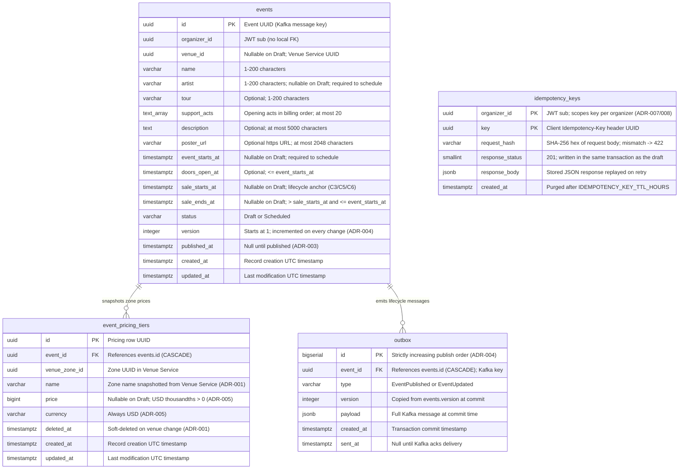

# Data Model — Event Management API

This document defines the **target PostgreSQL data model** for the Event Management microservice (`event_store`), reconciled across [Capabilities C1–C6](../event-propagation/capabilities-and-design-event-propagation.md), [Service Contract](../event-propagation/contract-event-service.md), and [ADR-001 to ADR-011](../event-propagation/adrs-event-propagation.md), together with the migration delta from the initial schema currently on `main`.

---

## Design Decisions

| Topic | Decision | Rationale |
|---|---|---|
| **Organizer reference (`partners`)** | **Drop `partners` table and `fk_events_organizer_id`**. Store `events.organizer_id` as a plain `uuid NOT NULL` from the verified JWT `sub`. | Auth Service has no user-sync API or events (ADR-007 amendment). Trusting verified `HS256` JWT claims (`sub`, `role`) avoids phantom partner rows and cross-service coupling. |
| **Schedule, sales window & poster** | **Flatten onto `events`** (`event_starts_at`, `doors_open_at`, `sale_starts_at`, `sale_ends_at`, `poster_url`) and **drop `event_schedules`, `event_sales`, and `event_media`**. | Matches the 1:1 target Event contract and allows ADR-002 / ADR-004's single-statement conditional lock & version increment (`UPDATE events ... WHERE status = 'Draft' OR sale_starts_at > now() RETURNING *`) without joins. |
| **Opening acts (`support_acts`)** | **`TEXT[]` column on `events`**, in billing order (decided 2026-11-27; replaces the earlier `event_support_acts` child table). | Same reason as flattening the schedule: an edit stays one `UPDATE events ... RETURNING *`, and the event payload needs no join. A Postgres array keeps its order. Needs SeaORM's `postgres-array` feature (no new crate). |
| **Legacy event fields** | **Drop `event_type`, `age_policy`, and `terms`**. | Not part of C1 or the v1 service contract; keeps the schema aligned strictly with the contract. |
| **Zone pricing (`event_pricing_tiers`)** | **Keep table name `event_pricing_tiers`** (per ADR-001), store `price` as **nullable `bigint`** (`CHECK (price IS NULL OR price > 0)`), add `venue_zone_id` and `deleted_at`, drop `description` and `event_seats`. | Supports saving a draft after selecting a venue before every zone is priced (C2), enforces integer USD thousandths (ADR-005), and soft-deletes prior venue prices on venue change (ADR-001). |

---

## Target Entity-Relationship Diagram (PostgreSQL)



---

## Table Specifications

All timestamp columns use `TIMESTAMPTZ` (stored as UTC instants; ADR-002). All monetary values use `BIGINT` thousandths of a US dollar (`65500` = `$65.50`; ADR-005).

### 1. `events`

Aggregate root for an event across its lifecycle (`Draft` → `Scheduled` → Published (`published_at IS NOT NULL`) → Locked (`now() >= sale_starts_at`)).

| Column | Type | Nullable | Default | Constraints & Notes |
|---|---|---|---|---|
| `id` | `UUID` | No | — | `PRIMARY KEY` (server-generated UUID v4) |
| `organizer_id` | `UUID` | No | — | Taken strictly from verified JWT `sub` (ADR-007) |
| `venue_id` | `UUID` | Yes | `NULL` | Venue UUID in Venue Service; required before scheduling (C4) |
| `name` | `VARCHAR(200)` | No | — | `CHECK (btrim(name) <> '')` |
| `artist` | `VARCHAR(200)` | Yes | `NULL` | `CHECK (artist IS NULL OR btrim(artist) <> '')`; required to schedule (C4) |
| `tour` | `VARCHAR(200)` | Yes | `NULL` | `CHECK (tour IS NULL OR btrim(tour) <> '')` |
| `support_acts` | `TEXT[]` | No | `'{}'` | Opening acts in billing order. `CHECK (cardinality(support_acts) <= 20)`; each entry 1–200 characters, checked in the service (a `CHECK` cannot loop over array elements without a function) |
| `description` | `TEXT` | Yes | `NULL` | `CHECK (description IS NULL OR char_length(description) <= 5000)` |
| `poster_url` | `VARCHAR(2048)` | Yes | `NULL` | `CHECK (poster_url IS NULL OR poster_url LIKE 'https://%')` |
| `event_starts_at` | `TIMESTAMPTZ` | Yes | `NULL` | Show start time (UTC); required to schedule (C4) |
| `doors_open_at` | `TIMESTAMPTZ` | Yes | `NULL` | Optional doors time; must satisfy `doors_open_at <= event_starts_at` |
| `sale_starts_at` | `TIMESTAMPTZ` | Yes | `NULL` | Sales window open (UTC); lifecycle anchor for C5 lock & C6 visibility |
| `sale_ends_at` | `TIMESTAMPTZ` | Yes | `NULL` | Sales window close (UTC); set together with `sale_starts_at` |
| `status` | `VARCHAR(20)` | No | `'Draft'` | `CHECK (status IN ('Draft', 'Scheduled'))` |
| `version` | `INTEGER` | No | `1` | `CHECK (version >= 1)`; incremented atomically on every change: each accepted edit, scheduling and publication (ADR-004) |
| `published_at` | `TIMESTAMPTZ` | Yes | `NULL` | Set once when propagated (ADR-003); `NULL` for drafts and unpublished scheduled events |
| `created_at` | `TIMESTAMPTZ` | No | `now()` | Record creation time |
| `updated_at` | `TIMESTAMPTZ` | No | `now()` | Last accepted update time |

**Table-level `CHECK` constraints:**
- `chk_events_doors_order`: `doors_open_at IS NULL OR event_starts_at IS NULL OR doors_open_at <= event_starts_at`
- `chk_events_sales_window_pair`: `(sale_starts_at IS NULL AND sale_ends_at IS NULL) OR (sale_starts_at IS NOT NULL AND sale_ends_at IS NOT NULL AND sale_starts_at < sale_ends_at)`
- `chk_events_sales_before_show`: `sale_ends_at IS NULL OR event_starts_at IS NULL OR sale_ends_at <= event_starts_at`
- `chk_events_scheduled_completeness`:
  ```sql
  status <> 'Scheduled' OR (
      artist IS NOT NULL
      AND venue_id IS NOT NULL
      AND event_starts_at IS NOT NULL
      AND sale_starts_at IS NOT NULL
      AND sale_ends_at IS NOT NULL
  )
  ```
- `chk_events_published_only_when_scheduled`: `published_at IS NULL OR status = 'Scheduled'`

**Indexes:**
- `idx_events_public_listing` ON `events (event_starts_at ASC, id ASC) WHERE published_at IS NOT NULL` — powers `GET /api/v1/events`: published events whose show has not started (`event_starts_at > now()`), soonest first.
- `idx_events_organizer` ON `events (organizer_id, updated_at DESC, id DESC)` — powers `GET /api/v1/events/mine` (most recently updated first) and the public `organizer_id` filter.
- `idx_events_venue` ON `events (venue_id) WHERE venue_id IS NOT NULL` — powers public `venue_id` filter.
- `idx_events_pending_publish` ON `events (sale_starts_at ASC, id ASC) WHERE status = 'Scheduled' AND published_at IS NULL` — powers the ADR-003 publish job (`sale_starts_at <= now() + interval`).

The `id` in each index breaks ties, so paging and the job's order are stable.

Text limits match the contract's [field limits](../event-propagation/contract-event-service.md#field-limits). The service checks them first and returns `422`; the column sizes and checks are the backstop. Lengths count characters, as Postgres does.

---

### 2. `event_pricing_tiers`

Stores one snapshotted zone pricing row per active venue zone of an event (C2, ADR-001, ADR-005). Exposed as `zones[]` in the API and Kafka payloads.

| Column | Type | Nullable | Default | Constraints & Notes |
|---|---|---|---|---|
| `id` | `UUID` | No | — | `PRIMARY KEY` |
| `event_id` | `UUID` | No | — | `REFERENCES events(id) ON DELETE CASCADE` |
| `venue_zone_id` | `UUID` | No | — | Zone UUID in Venue Service |
| `name` | `VARCHAR(255)` | No | — | Zone name snapshotted from Venue Service; never accepted from client (ADR-007) |
| `price` | `BIGINT` | Yes | `NULL` | `CHECK (price IS NULL OR price > 0)`; thousandths of USD; nullable only while `Draft` |
| `currency` | `VARCHAR(3)` | No | `'USD'` | `CHECK (currency = 'USD')` (ADR-005) |
| `deleted_at` | `TIMESTAMPTZ` | Yes | `NULL` | Set on previous venue's rows when the venue changes (ADR-001) |
| `created_at` | `TIMESTAMPTZ` | No | `now()` | Record creation time |
| `updated_at` | `TIMESTAMPTZ` | No | `now()` | Last price update time |

**Constraints & Indexes:**
- `uq_event_pricing_tiers_active_zone`: `CREATE UNIQUE INDEX uq_event_pricing_tiers_active_zone ON event_pricing_tiers (event_id, venue_zone_id) WHERE deleted_at IS NULL` — guarantees one active price row per zone per event while preserving soft-deleted rows from prior venues (ADR-001).

**Query rules:**
- Every read of zone prices—including `GET`, `min_price` computation, Kafka payload assembly, and the C4 schedule check (at least 1 active row, and zero active rows with `price IS NULL`)—MUST filter `WHERE deleted_at IS NULL`.
- Every `PUT /api/v1/events/{id}/venue` reads the venue's zones from Venue Service again (ADR-001, amended 2026-11-27). On the same venue: zones still in the venue update their active row in place (current name; new price if the request has one, otherwise the price stays); zones no longer in the venue get `deleted_at = now()`; new zones get a row, without a price unless the request has one. A `venue_zone_id` listed twice in the request takes its last entry. Changing `venue_id` sets `deleted_at = now()` on existing active rows and inserts snapshots for the new venue's zones inside the same transaction.

---

### 3. `outbox`

Transactional outbox for `events.lifecycle` Kafka propagation (C6, ADR-004).

| Column | Type | Nullable | Default | Constraints & Notes |
|---|---|---|---|---|
| `id` | `BIGSERIAL` | No | sequence | `PRIMARY KEY`; defines strict relay publish order |
| `event_id` | `UUID` | No | — | `REFERENCES events(id) ON DELETE RESTRICT`; Kafka partition key. `RESTRICT`, not `CASCADE`: deleting an event must never silently drop unsent messages |
| `type` | `VARCHAR(32)` | No | — | `CHECK (type IN ('EventPublished', 'EventUpdated'))` |
| `version` | `INTEGER` | No | — | `CHECK (version >= 1)`; copied from `events.version` at commit |
| `payload` | `JSONB` | No | — | Full Kafka envelope (`type`, `event_id`, `version`, `occurred_at`, `event`) built at commit time |
| `created_at` | `TIMESTAMPTZ` | No | `now()` | When the outbox row was written |
| `sent_at` | `TIMESTAMPTZ` | Yes | `NULL` | Set only after Kafka confirms delivery |

**Indexes:**
- `idx_outbox_unsent` ON `outbox (id ASC) WHERE sent_at IS NULL` — fast batch polling for the outbox relay (`LIMIT OUTBOX_RELAY_BATCH_SIZE`).

**Relay (ADR-009):** only one relay reads this table at a time. Each run is one transaction that starts with `pg_try_advisory_xact_lock(<relay lock id>)`; if the lock is taken by another instance, the run reads nothing and waits for the next interval.
- `idx_outbox_event_id` ON `outbox (event_id)` — supports inspection by event.

---

### 4. `idempotency_keys`

Stores `Idempotency-Key` records for `POST /api/v1/events` (ADR-008), scoped per organizer so one organizer can never read another's stored response (ADR-007).

| Column | Type | Nullable | Default | Constraints & Notes |
|---|---|---|---|---|
| `organizer_id` | `UUID` | No | — | Part of composite PK; from verified JWT `sub` |
| `key` | `UUID` | No | — | Part of composite PK; client `Idempotency-Key` header |
| `request_hash` | `VARCHAR(64)` | No | — | SHA-256 hex digest of the request as parsed (DTO serialized back to JSON), so whitespace and key order do not matter |
| `response_status` | `SMALLINT` | Yes | `NULL` | HTTP status (`201`). `NULL` only inside the creating transaction, so never visible to another request |
| `response_body` | `JSONB` | Yes | `NULL` | Serialized Event JSON. `NULL` only inside the creating transaction |
| `created_at` | `TIMESTAMPTZ` | No | `now()` | Used for TTL cleanup (`IDEMPOTENCY_KEY_TTL_HOURS`) |

**Constraints & Indexes:**
- `PRIMARY KEY (organizer_id, key)`
- `idx_idempotency_keys_created_at` ON `idempotency_keys (created_at ASC)` — used by the scheduled job to purge rows older than `IDEMPOTENCY_KEY_TTL_HOURS`.

**Lifecycle (ADR-008, amended 2026-11-27):** the key and the draft are written in **one transaction**.
1. `BEGIN`. Delete any record for `(organizer_id, key)` whose `created_at < now() - make_interval(hours => IDEMPOTENCY_KEY_TTL_HOURS)`, so expiry is exact even between cleanup runs.
2. `INSERT (organizer_id, key, request_hash, NULL, NULL) ON CONFLICT DO NOTHING RETURNING key`. If another transaction holds an uncommitted row with the same key, Postgres makes this insert wait until that transaction ends. The wait is bounded by `DB_STATEMENT_TIMEOUT_MS`; past it, `503` with `Retry-After`.
3. If a row was inserted, this request creates the draft, sets `response_status` and `response_body` on its key row, and commits.
4. If nothing was inserted, the key already exists and is committed with its response. Roll back, then read the row:
   - Different `request_hash` → `422`.
   - Same `request_hash` → replay `(response_status, response_body)`.
5. If draft creation fails, the transaction rolls back and the key goes with it, so the client can retry. A request that was waiting on that key then inserts it and creates the draft itself.

No other request ever sees a key without its response, so there is no "in progress" answer (no `409`), and a crash leaves no key behind.

---

## Core Transactional Patterns

- **Atomic edit + lock + version + outbox (C5, ADR-002, ADR-004):**
  Every edit endpoint (`PATCH /{id}`, `PUT /{id}/venue`, `PUT /{id}/sales-window`) runs in one PostgreSQL transaction:
  ```sql
  UPDATE events
  SET ..., version = version + 1, updated_at = now()
  WHERE id = $1
    AND organizer_id = $2
    AND (status = 'Draft' OR sale_starts_at > now())
  RETURNING *;
  ```
  - 0 rows updated when event exists for organizer → roll back and return `409 Event Locked`.
  - Apply zone changes (`event_pricing_tiers`) in the same transaction. `support_acts` is a column, so it is part of the `UPDATE`.
  - If the `RETURNING` row is `Scheduled` with `published_at IS NULL`, run the visibility check on this event (below); if it publishes the event, insert `EventPublished` instead of `EventUpdated`. `version` is not incremented again (ADR-003, ADR-004):
    ```sql
    UPDATE events SET published_at = now()
    WHERE id = $1 AND status = 'Scheduled' AND published_at IS NULL
      AND sale_starts_at <= now() + make_interval(hours => 24 * $lead_days)
    RETURNING *;
    ```
  - Otherwise, if the `RETURNING` row has `published_at IS NOT NULL`, assemble the full event payload (including active zones) and insert an `EventUpdated` row into `outbox` before committing.

- **Scheduled publish job (C6, ADR-003, ADR-004, ADR-009):**
  Runs every `EVENT_PUBLISH_JOB_INTERVAL_SECONDS`. Each event is published in its own transaction, at most `EVENT_PUBLISH_JOB_BATCH_SIZE` per run; a run that reaches the limit starts the next one at once:
  ```sql
  UPDATE events
  SET published_at = now(), version = version + 1, updated_at = now()
  WHERE id = (
      SELECT id FROM events
      WHERE status = 'Scheduled'
        AND published_at IS NULL
        AND sale_starts_at <= now() + make_interval(hours => 24 * $lead_days)
      ORDER BY sale_starts_at, id
      LIMIT 1
      FOR UPDATE SKIP LOCKED
  )
  RETURNING *;
  ```
  Inserts `EventPublished` into `outbox` in the same transaction. The condition adds the lead time to `now()` so it can use `idx_events_pending_publish`, and uses hours so a day is always 24 hours. `SKIP LOCKED` lets jobs on several instances split the work. It does not check whether sales have opened: after an outage it still publishes the event late (ADR-003). Also cleans up expired `idempotency_keys`.

- **Scheduling (C4, C5, C6, ADR-002, ADR-003):**
  `POST /api/v1/events/{id}/schedule` validates all C4 rules (including at least one active zone and zero unpriced active zones), then in one transaction:
  ```sql
  UPDATE events
  SET status = 'Scheduled', version = version + 1, updated_at = now()
  WHERE id = $1 AND organizer_id = $2 AND status = 'Draft'
  RETURNING *;
  ```
  followed by the same visibility check as an edit, which may set `published_at` and insert `EventPublished`. An event that is already `Scheduled` is returned unchanged while `sale_starts_at > now()`, and gets `409` after.

- **Session settings.** Every database connection sets `TimeZone = 'UTC'` and `statement_timeout = DB_STATEMENT_TIMEOUT_MS` when it opens, so no expression depends on a server's local time zone.

---

## Migration Delta: Current Schema → Target Schema

No environment holds live data yet (confirmed 2026-11-27), so the target schema keeps no rows from the initial schema. The database created by [m20260101_000001_create_initial_tables.rs](../../src/migration/m20260101_000001_create_initial_tables.rs) and [m20260101_000002_seed_dev_partners.rs](../../src/migration/m20260101_000002_seed_dev_partners.rs) is replaced by **one new migration** (`mYYYYMMDD_NNNNNN_target_event_schema.rs`, registered in `src/migration/mod.rs`). Never edit the two merged migrations.

| Step | Tables | Source |
|---|---|---|
| **Drop** (children first) | `event_seats`, `event_media`, `event_sales`, `event_schedules`, `event_pricing_tiers`, `events`, `partners` (this also removes `fk_events_organizer_id` and the seeded dev partners) | ADR-001, ADR-007, Design Decisions |
| **Create** | `events`, `event_pricing_tiers`, `outbox`, `idempotency_keys`, with every column, check constraint and index specified above | C1–C6, ADR-001 to ADR-005, ADR-008 |

`down` drops the target tables and recreates the initial tables empty.

The data conversions planned earlier (copying schedules, sales and media onto `events`, multiplying prices by 1000, downgrading incomplete `Scheduled` events to `Draft`) are no longer needed. If an environment gets live data before this migration ships, this section must be revisited first.
