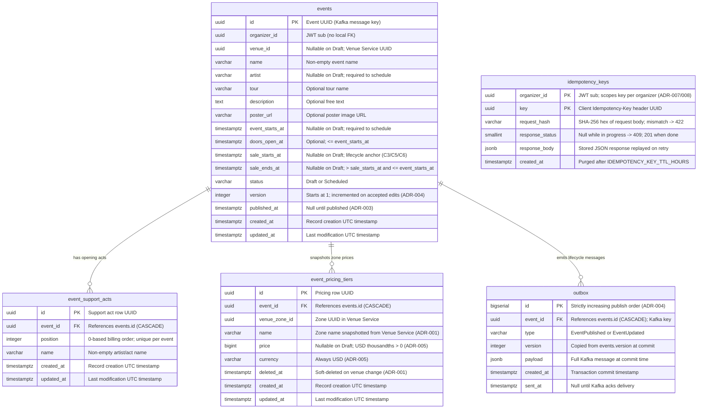

# Data Model — Event Management API

This document defines the **target PostgreSQL data model** for the Event Management microservice (`event_store`), reconciled across [Capabilities C1–C6](../event-propagation/capabilities-and-design-event-propagation.md), [Service Contract](../event-propagation/contract-event-service.md), and [ADR-001 to ADR-008](../event-propagation/adrs-event-propagation.md), together with the migration delta from the initial schema currently on `main`.

---

## Design Decisions

| Topic | Decision | Rationale |
|---|---|---|
| **Organizer reference (`partners`)** | **Drop `partners` table and `fk_events_organizer_id`**. Store `events.organizer_id` as a plain `uuid NOT NULL` from the verified JWT `sub`. | Auth Service has no user-sync API or events (ADR-007 amendment). Trusting verified `HS256` JWT claims (`sub`, `role`) avoids phantom partner rows and cross-service coupling. |
| **Schedule, sales window & poster** | **Flatten onto `events`** (`event_starts_at`, `doors_open_at`, `sale_starts_at`, `sale_ends_at`, `poster_url`) and **drop `event_schedules`, `event_sales`, and `event_media`**. | Matches the 1:1 target Event contract and allows ADR-002 / ADR-004's single-statement conditional lock & version increment (`UPDATE events ... WHERE status = 'Draft' OR sale_starts_at > now() RETURNING *`) without joins. |
| **Opening acts (`support_acts`)** | **Separate child table `event_support_acts`** (`event_id`, `position`, `name`). | Keeps opening acts normalized in explicit billing order (`UNIQUE (event_id, position)`). |
| **Legacy event fields** | **Drop `event_type`, `age_policy`, and `terms`**. | Not part of C1 or the v1 service contract; keeps the schema aligned strictly with the contract. |
| **Zone pricing (`event_pricing_tiers`)** | **Keep table name `event_pricing_tiers`** (per ADR-001), store `price` as **nullable `bigint`** (`CHECK (price IS NULL OR price > 0)`), add `venue_zone_id` and `deleted_at`, drop `description` and `event_seats`. | Supports saving a draft after selecting a venue before every zone is priced (C2), enforces integer USD thousandths (ADR-005), and soft-deletes prior venue prices on venue change (ADR-001). |

---

## Target Entity-Relationship Diagram (PostgreSQL)



---

## Table Specifications

All timestamp columns use `TIMESTAMPTZ` (stored as UTC instants; ADR-002). All monetary values use `BIGINT` thousandths of a US dollar (`65500` = `$65.50`; ADR-005).

### 1. `events`

Aggregate root for an event across its lifecycle (`Draft` → `Scheduled` → Published (`published_at IS NOT NULL`) → Locked (`now() >= sale_starts_at`)).

| Column | Type | Nullable | Default | Constraints & Notes |
|---|---|---|---|---|
| `id` | `UUID` | No | — | `PRIMARY KEY` (server-generated UUID v4) |
| `organizer_id` | `UUID` | No | — | Taken strictly from verified JWT `sub` (ADR-007) |
| `venue_id` | `UUID` | Yes | `NULL` | Venue UUID in Venue Service; required before scheduling (C4) |
| `name` | `VARCHAR(255)` | No | — | `CHECK (btrim(name) <> '')` |
| `artist` | `VARCHAR(255)` | Yes | `NULL` | `CHECK (artist IS NULL OR btrim(artist) <> '')`; required to schedule (C4) |
| `tour` | `VARCHAR(255)` | Yes | `NULL` | Optional tour name |
| `description` | `TEXT` | Yes | `NULL` | Optional free-text description |
| `poster_url` | `VARCHAR(1024)` | Yes | `NULL` | Optional poster image URL |
| `event_starts_at` | `TIMESTAMPTZ` | Yes | `NULL` | Show start time (UTC); required to schedule (C4) |
| `doors_open_at` | `TIMESTAMPTZ` | Yes | `NULL` | Optional doors time; must satisfy `doors_open_at <= event_starts_at` |
| `sale_starts_at` | `TIMESTAMPTZ` | Yes | `NULL` | Sales window open (UTC); lifecycle anchor for C5 lock & C6 visibility |
| `sale_ends_at` | `TIMESTAMPTZ` | Yes | `NULL` | Sales window close (UTC); set together with `sale_starts_at` |
| `status` | `VARCHAR(20)` | No | `'Draft'` | `CHECK (status IN ('Draft', 'Scheduled'))` |
| `version` | `INTEGER` | No | `1` | `CHECK (version >= 1)`; incremented atomically on every accepted edit (ADR-004) |
| `published_at` | `TIMESTAMPTZ` | Yes | `NULL` | Set once when propagated (ADR-003); `NULL` for drafts and unpublished scheduled events |
| `created_at` | `TIMESTAMPTZ` | No | `now()` | Record creation time |
| `updated_at` | `TIMESTAMPTZ` | No | `now()` | Last accepted update time |

**Table-level `CHECK` constraints:**
- `chk_events_doors_order`: `doors_open_at IS NULL OR event_starts_at IS NULL OR doors_open_at <= event_starts_at`
- `chk_events_sales_window_pair`: `(sale_starts_at IS NULL AND sale_ends_at IS NULL) OR (sale_starts_at IS NOT NULL AND sale_ends_at IS NOT NULL AND sale_starts_at < sale_ends_at)`
- `chk_events_sales_before_show`: `sale_ends_at IS NULL OR event_starts_at IS NULL OR sale_ends_at <= event_starts_at`
- `chk_events_scheduled_completeness`:
  ```sql
  status <> 'Scheduled' OR (
      artist IS NOT NULL
      AND venue_id IS NOT NULL
      AND event_starts_at IS NOT NULL
      AND sale_starts_at IS NOT NULL
      AND sale_ends_at IS NOT NULL
  )
  ```
- `chk_events_published_only_when_scheduled`: `published_at IS NULL OR status = 'Scheduled'`

**Indexes:**
- `idx_events_public_listing` ON `events (event_starts_at ASC) WHERE published_at IS NOT NULL` — powers `GET /api/v1/events` (published only, soonest first).
- `idx_events_organizer` ON `events (organizer_id, created_at DESC)` — powers `GET /api/v1/events/mine` and public `organizer_id` filter.
- `idx_events_venue` ON `events (venue_id) WHERE venue_id IS NOT NULL` — powers public `venue_id` filter.
- `idx_events_pending_publish` ON `events (sale_starts_at ASC) WHERE status = 'Scheduled' AND published_at IS NULL` — powers the ADR-003 publish scheduler.

---

### 2. `event_support_acts`

Stores `support_acts` (`string[]`) in explicit billing order (C1). Replaced atomically inside the same transaction as `PATCH /api/v1/events/{id}` (or `POST /api/v1/events`) when `support_acts` is provided.

| Column | Type | Nullable | Default | Constraints & Notes |
|---|---|---|---|---|
| `id` | `UUID` | No | — | `PRIMARY KEY` |
| `event_id` | `UUID` | No | — | `REFERENCES events(id) ON DELETE CASCADE` |
| `position` | `INTEGER` | No | — | `CHECK (position >= 0)`; 0-based billing order |
| `name` | `VARCHAR(255)` | No | — | `CHECK (btrim(name) <> '')` |
| `created_at` | `TIMESTAMPTZ` | No | `now()` | Record creation time |
| `updated_at` | `TIMESTAMPTZ` | No | `now()` | Record update time |

**Constraints & Indexes:**
- `uq_event_support_acts_event_position`: `UNIQUE (event_id, position)` (also serves ordered reads `WHERE event_id = $1 ORDER BY position ASC`).

---

### 3. `event_pricing_tiers`

Stores one snapshotted zone pricing row per active venue zone of an event (C2, ADR-001, ADR-005). Exposed as `zones[]` in the API and Kafka payloads.

| Column | Type | Nullable | Default | Constraints & Notes |
|---|---|---|---|---|
| `id` | `UUID` | No | — | `PRIMARY KEY` |
| `event_id` | `UUID` | No | — | `REFERENCES events(id) ON DELETE CASCADE` |
| `venue_zone_id` | `UUID` | No | — | Zone UUID in Venue Service |
| `name` | `VARCHAR(255)` | No | — | Zone name snapshotted from Venue Service; never accepted from client (ADR-007) |
| `price` | `BIGINT` | Yes | `NULL` | `CHECK (price IS NULL OR price > 0)`; thousandths of USD; nullable only while `Draft` |
| `currency` | `VARCHAR(3)` | No | `'USD'` | `CHECK (currency = 'USD')` (ADR-005) |
| `deleted_at` | `TIMESTAMPTZ` | Yes | `NULL` | Set on previous venue's rows when the venue changes (ADR-001) |
| `created_at` | `TIMESTAMPTZ` | No | `now()` | Record creation time |
| `updated_at` | `TIMESTAMPTZ` | No | `now()` | Last price update time |

**Constraints & Indexes:**
- `uq_event_pricing_tiers_active_zone`: `CREATE UNIQUE INDEX uq_event_pricing_tiers_active_zone ON event_pricing_tiers (event_id, venue_zone_id) WHERE deleted_at IS NULL` — guarantees one active price row per zone per event while preserving soft-deleted rows from prior venues (ADR-001).

**Query rules:**
- Every read of zone prices—including `GET`, `min_price` computation, Kafka payload assembly, and the C4 schedule check (at least 1 active row, and zero active rows with `price IS NULL`)—MUST filter `WHERE deleted_at IS NULL`.
- Updating prices on the same venue updates active rows in place (ADR-001). Changing `venue_id` sets `deleted_at = now()` on existing active rows and inserts snapshots for the new venue's zones inside the same transaction.

---

### 4. `outbox`

Transactional outbox for `events.lifecycle` Kafka propagation (C6, ADR-004).

| Column | Type | Nullable | Default | Constraints & Notes |
|---|---|---|---|---|
| `id` | `BIGSERIAL` | No | sequence | `PRIMARY KEY`; defines strict relay publish order |
| `event_id` | `UUID` | No | — | `REFERENCES events(id) ON DELETE CASCADE`; Kafka partition key |
| `type` | `VARCHAR(32)` | No | — | `CHECK (type IN ('EventPublished', 'EventUpdated'))` |
| `version` | `INTEGER` | No | — | `CHECK (version >= 1)`; copied from `events.version` at commit |
| `payload` | `JSONB` | No | — | Full Kafka envelope (`type`, `event_id`, `version`, `occurred_at`, `event`) built at commit time |
| `created_at` | `TIMESTAMPTZ` | No | `now()` | When the outbox row was written |
| `sent_at` | `TIMESTAMPTZ` | Yes | `NULL` | Set only after Kafka confirms delivery |

**Indexes:**
- `idx_outbox_unsent` ON `outbox (id ASC) WHERE sent_at IS NULL` — fast batch polling for the outbox relay (`LIMIT OUTBOX_RELAY_BATCH_SIZE`).
- `idx_outbox_event_id` ON `outbox (event_id)` — supports inspection by event.

---

### 5. `idempotency_keys`

Stores `Idempotency-Key` records for `POST /api/v1/events` (ADR-008), scoped per organizer so one organizer can never read another's stored response (ADR-007).

| Column | Type | Nullable | Default | Constraints & Notes |
|---|---|---|---|---|
| `organizer_id` | `UUID` | No | — | Part of composite PK; from verified JWT `sub` |
| `key` | `UUID` | No | — | Part of composite PK; client `Idempotency-Key` header |
| `request_hash` | `VARCHAR(64)` | No | — | SHA-256 hex digest of normalized request payload |
| `response_status` | `SMALLINT` | Yes | `NULL` | `NULL` while in flight; HTTP status (`201`) once completed |
| `response_body` | `JSONB` | Yes | `NULL` | `NULL` while in flight; serialized Event JSON once completed |
| `created_at` | `TIMESTAMPTZ` | No | `now()` | Used for TTL cleanup (`IDEMPOTENCY_KEY_TTL_HOURS`) |

**Constraints & Indexes:**
- `PRIMARY KEY (organizer_id, key)`
- `idx_idempotency_keys_created_at` ON `idempotency_keys (created_at ASC)` — used by the scheduled job to purge rows older than `IDEMPOTENCY_KEY_TTL_HOURS`.

**Lifecycle (ADR-008):**
1. On `POST /api/v1/events`, first purge or ignore any existing record for `(organizer_id, key)` whose `created_at < now() - make_interval(hours => IDEMPOTENCY_KEY_TTL_HOURS)` so TTL expiry is exact even between scheduled cleanup runs, then insert `(organizer_id, key, request_hash, NULL, NULL)` with `ON CONFLICT DO NOTHING`.
2. If an unexpired key already exists:
   - Different `request_hash` → return `422`.
   - Same `request_hash` and `response_status IS NULL` → return `409` (first request still running).
   - Same `request_hash` and `response_status IS NOT NULL` → replay `(response_status, response_body)`.
3. On successful draft creation, update `response_status` and `response_body` in the same transaction (if draft creation fails, delete/roll back the in-flight key so the client can retry).

---

## Core Transactional Patterns

- **Atomic edit + lock + version + outbox (C5, ADR-002, ADR-004):**
  Every edit endpoint (`PATCH /{id}`, `PUT /{id}/venue`, `PUT /{id}/sales-window`) runs in one PostgreSQL transaction:
  ```sql
  UPDATE events
  SET ..., version = version + 1, updated_at = now()
  WHERE id = $1
    AND organizer_id = $2
    AND (status = 'Draft' OR sale_starts_at > now())
  RETURNING *;
  ```
  - 0 rows updated when event exists for organizer → roll back and return `409 Event Locked`.
  - Apply child changes (`event_support_acts` or `event_pricing_tiers`) in the same transaction.
  - If the `RETURNING` row has `published_at IS NOT NULL`, assemble the full event payload (including active zones and ordered support acts) and insert an `EventUpdated` row into `outbox` before committing.

- **Scheduled publish job (C6, ADR-003, ADR-004):**
  Runs every `EVENT_PUBLISH_JOB_INTERVAL_SECONDS`:
  ```sql
  UPDATE events
  SET published_at = now()
  WHERE id = $1
    AND status = 'Scheduled'
    AND published_at IS NULL
    AND sale_starts_at - make_interval(days => $2) <= now()
  RETURNING *;
  ```
  `version` is unchanged; inserts `EventPublished` into `outbox` in the same transaction. Also cleans up expired `idempotency_keys`.

- **Immediate publish on schedule (C4, C6, ADR-003):**
  `POST /api/v1/events/{id}/schedule` validates all C4 rules (including at least one active zone and zero unpriced active zones). If `sale_starts_at - EVENT_VISIBILITY_LEAD_DAYS <= now()`, it sets `status = 'Scheduled'` and `published_at = now()` and inserts `EventPublished` into `outbox` in the same transaction.

---

## Migration Delta: Current Schema → Target Schema

The current database created by [m20260101_000001_create_initial_tables.rs](../../src/migration/m20260101_000001_create_initial_tables.rs) and [m20260101_000002_seed_dev_partners.rs](../../src/migration/m20260101_000002_seed_dev_partners.rs) has 7 tables. Never edit those merged migrations; apply the following changes via new SeaORM migration file(s) (`mYYYYMMDD_NNNNNN_*.rs`):

| Current Table / Column | Target Action | Source |
|---|---|---|
| `partners` & `fk_events_organizer_id` | **Drop** table and FK constraint | ADR-007 + Design Decision |
| `event_seats` | **Drop** table (seats live in Venue Service) | ADR-001 |
| `event_schedules` | **Migrate** earliest `starts_at` → `events.event_starts_at`, then **drop** table | C1 + Design Decision |
| `event_sales` | **Migrate** `starts_at`/`ends_at` → `events.sale_starts_at`/`sale_ends_at`, then **drop** table | C3 + ADR-002 + Design Decision |
| `event_media` | **Migrate** poster `url` → `events.poster_url`, then **drop** table | C1 + Design Decision |
| `events.venue_id` | **Alter** to `NULL` (drafts start without a venue) | C1, C2 |
| `events.event_type`, `age_policy`, `terms` | **Drop** columns | Design Decision |
| `events` (new columns) | **Add** `tour`, `poster_url`, `event_starts_at`, `doors_open_at`, `sale_starts_at`, `sale_ends_at`, `version` (`DEFAULT 1`), `published_at`, check constraints, and indexes | C1, C3, ADR-002, ADR-003, ADR-004 |
| `event_support_acts` | **Create** table with `UNIQUE (event_id, position)` | C1 + Design Decision |
| `event_pricing_tiers` | Clean up any legacy dev rows lacking a zone ID; **add** `venue_zone_id NOT NULL`, `deleted_at`, partial unique index; **widen** `name` to `VARCHAR(255)`; **convert** `price` from `DECIMAL(12,2)` to nullable `BIGINT` (`* 1000`); set `currency = 'USD'` with check; **drop** `description` | C2, ADR-001, ADR-005 |
| `outbox` | **Create** table + `idx_outbox_unsent` | C6, ADR-004 |
| `idempotency_keys` | **Create** table + `idx_idempotency_keys_created_at` | ADR-008 |
