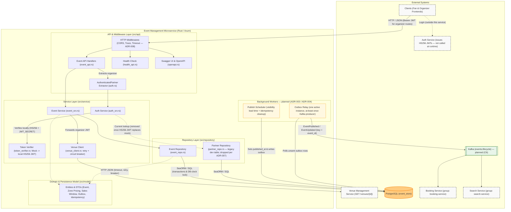

# Component Diagram — Event Management Microservice

This document describes the internal components and external boundaries of the **Event Management Microservice** (Rust / Axum / SeaORM / PostgreSQL).

- **Implemented today:** HTTP API (`GET/POST /api/v1/events`, `GET /api/v1/events/{id}`, `/health`, Swagger UI), `EventService`, `AuthService`, `MockTokenVerifier`, `HttpVenueClient` / `MockVenueClient`, `EventRepository`, and `PartnerRepository`.
- **Target Event Propagation additions** (specified in [Capabilities C1–C6](event-propagation/capabilities-and-design-event-propagation.md), [Service Contract](event-propagation/contract-event-service.md), and [ADR-001 to ADR-011](event-propagation/adrs-event-propagation.md)): local `HS256` JWT verifier, resiliency middleware and circuit breaker, draft-to-scheduled workflow endpoints, `Publish Scheduler`, `Outbox Relay`, and Kafka (`events.lifecycle`).

## Layer & Component Responsibilities

1. **API & Middleware Layer (`src/api`, `src/openapi.rs`)**
   - Exposes REST endpoints under `/api/v1/events` (with `/events` as a compatibility alias), `/health`, `/swagger-ui`, and `/api-docs/openapi.json`.
   - Applies cross-cutting HTTP middleware (`CorsLayer`, `TraceLayer`, and an Axum middleware that cuts each request at `HTTP_REQUEST_TIMEOUT_MS` with `503` and `Retry-After`, per ADR-008).
   - `AuthenticatedPartner` (`src/api/auth.rs`) is an Axum `FromRequestParts` extractor—not a standalone HTTP endpoint—that parses `Authorization: Bearer <token>` and delegates to `AuthService`.

2. **Service Layer (`src/service`)**
   - Owns all business validation, lifecycle transitions, ownership checks, and external client orchestration. Contains no HTTP types.
   - `EventService`: Orchestrates event creation, edits, venue/zone pricing snapshots, sales-window rules, scheduling, and lock enforcement.
   - `AuthService` & `TokenVerifier`: Verifies bearer tokens locally. Per amended ADR-007 and ADR-008, production verification uses `HS256` with the shared `JWT_SECRET` (no runtime network call to Auth Service). There are no mock tokens in the target design (ADR-007, amended 2026-11-27); `MockTokenVerifier` exists only until the verifier is replaced.
   - `VenueClient`: Trait (`HttpVenueClient` / `MockVenueClient`) communicating with Venue Service via `reqwest`. Calls `GET /venues/{id}` forwarding the organizer's bearer token to validate venues and snapshot zone metadata, protected by per-attempt timeout, full-jitter retries, and a circuit breaker (ADR-008).

3. **Background Workers (Planned — ADR-003, ADR-004, ADR-008, ADR-009)**
   - **Publish Scheduler:** Runs every `EVENT_PUBLISH_JOB_INTERVAL_SECONDS` against PostgreSQL only (no token or external calls). Marks `Scheduled` events as published once `sale_starts_at - EVENT_VISIBILITY_LEAD_DAYS <= now()`, writes `EventPublished` to the outbox in the same transaction, and purges expired `idempotency_keys`.
   - **Outbox Relay:** Polls unsent outbox rows every `OUTBOX_RELAY_INTERVAL_MS` in `id` order and publishes full-state `EventPublished` / `EventUpdated` messages to Kafka topic `events.lifecycle` (idempotent producer, `acks=all`, keyed by `event_id`). Every instance runs it, but a transaction-level Postgres advisory lock lets only one send at a time (ADR-009).

4. **Repository Layer (`src/repository`)**
   - Trait-backed data access (`EventRepository`, `PartnerRepository`) with SeaORM PostgreSQL implementations and in-memory `Mock*` implementations for tests.
   - Enforces transactional writes, atomic DB-clock locking (`WHERE status = 'Draft' OR sale_starts_at > now()`, ADR-002), and outbox inserts in the same transaction as event updates (ADR-004).

5. **Domain & Model Layer (`src/model`)**
   - Defines SeaORM entities and API/Kafka DTOs (`dtos.rs`).
   - **No seat storage:** Seats belong to Venue Service. Event Service snapshots only venue zones (`venue_zone_id`, copied `name`, and `price` as `i64` thousandths of USD per ADR-001 and ADR-005). The legacy `event_seats` table is unused and scheduled to be dropped.

6. **External Systems**
   - **PostgreSQL (`event_store`):** Sole persistent database owned by this microservice.
   - **Auth Service:** Issues `HS256` JWTs to clients (`sub`, `role`, `iat`, `exp`). Event Service never calls it during request handling.
   - **Venue Management Service:** Source of truth for venues, zones, and seats.
   - **Kafka (`events.lifecycle`):** Event stream consumed independently by **Booking Service** (`booking-service`) and **Search Service** (`search-service`).
