# Capabilities and Design - Event propagation

## C4 Level 2

[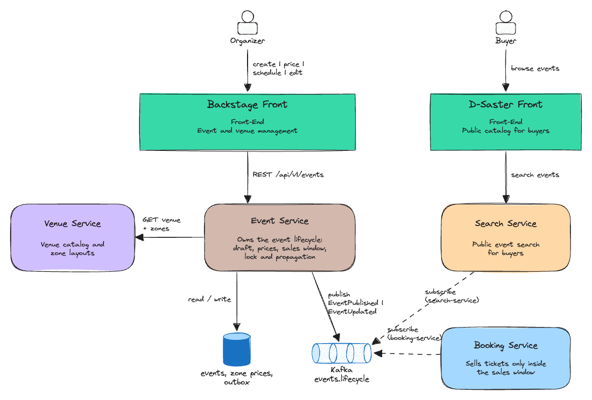](diagrams/01-c4-level-2.png)

## Happy path

An organizer builds an event in four steps and then schedules it. From there, the event moves on its own, driven by `sale_starts_at`, the moment sales open:

1. **Create** the event with a name (C1). It starts as a `Draft`, which only Event Service can see.
2. **Price the zones** of a venue from Venue Service (C2).
3. **Set the sales window**: when sales open and when they close (C3).
4. **Add the show details**: artist, tour, support acts, event date, doors time, description and poster (C1).
5. **Save** to schedule the event (C4). Event Service checks all four steps and moves the event to `Scheduled`.
6. **Visible**: `EVENT_VISIBILITY_LEAD_DAYS` (10 by default) before sales open, Event Service publishes the event to Booking Service and Search Service (C6).
7. **Locked**: once sales open, the event can no longer be edited (C5).

[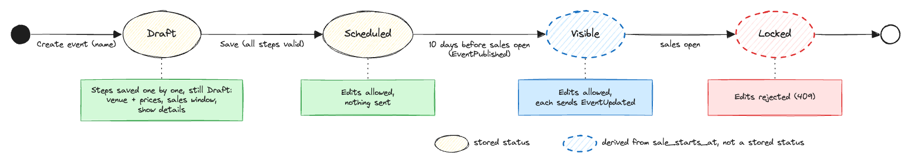](diagrams/02-happy-path.png)

---

## Capabilities

| # | Capability | ADRs |
|---|---|---|
| C1 | **Create a new event** | |
| C2 | **Select venue and price zones** | [ADR-001](adrs-event-propagation.md#adr-001---soft-delete-zone-prices-when-the-venue-changes) |
| C3 | **Set sales window** | |
| C4 | **Schedule the event** | |
| C5 | **Lock event after sale window opens** | [ADR-002](adrs-event-propagation.md#adr-002---use-the-database-clock-for-the-lock-and-timestamptz-for-all-times) |
| C6 | **Event propagation to other services** | [ADR-003](adrs-event-propagation.md#adr-003---publish-events-with-a-scheduled-job-at-the-visibility-moment), [ADR-004](adrs-event-propagation.md#adr-004---integer-event-version-and-full-state-messages) |

---

### C1 - Create a new event

> ***As an organizer, I can create an event with its name, artist and description, and keep working on it privately until it's ready.***

##### Expectations:

- Organizer captures the event name, artist, tour, support acts, event date, doors time, description and poster.
- Event is created in `Draft` state; a draft is never visible outside Event Service.
- Every step is persisted as it is completed, so the organizer can leave and resume the draft later.
- Event date is sent with its timezone offset and stored as an absolute UTC timestamp; it is displayed in the venue's timezone.

**ADRs:** \[links\]

##### Diagrams:

[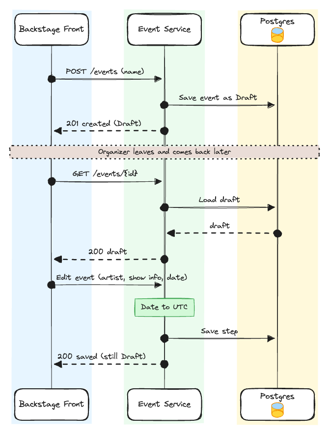\[Create a draft and resume it later\]](diagrams/c1-create-draft.png)

**Edge cases:**

[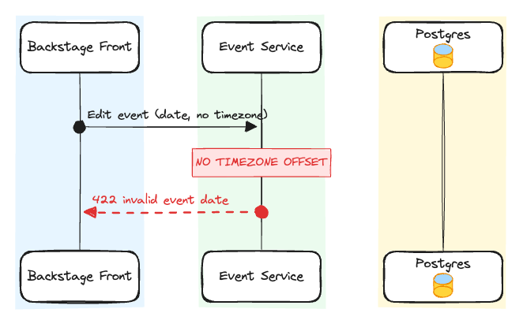\[Event date without timezone offset\]](diagrams/c1-edge-missing-offset.png)

[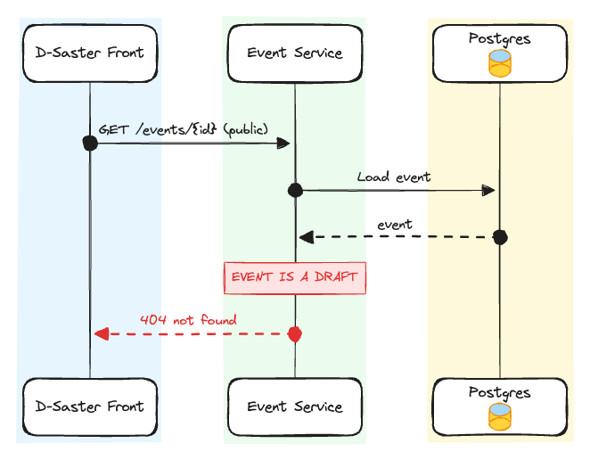\[Draft requested from a public endpoint\]](diagrams/c1-edge-draft-not-public.png)

---

### C2 - Select venue and price zones

> ***As an organizer, I pick where the show happens and set a price for every zone.***

##### Expectations:

- Organizer selects a venue from the existing venues in Venue Service (calling it directly via API); zones come from the venue layout; they are not defined per event.
- Every zone of the selected venue must have a price greater than 0, in the event currency.
- Each zone price references its zone in Venue Service and keeps a copy of the zone name.
- Zones and prices are snapshotted into the event; later changes to the venue layout never alter an existing event.
- Changing the venue soft-deletes the zone prices of the previous venue; soft-deleted prices are never used.

**ADRs:** [ADR-001](adrs-event-propagation.md#adr-001---soft-delete-zone-prices-when-the-venue-changes)

##### Diagrams:

[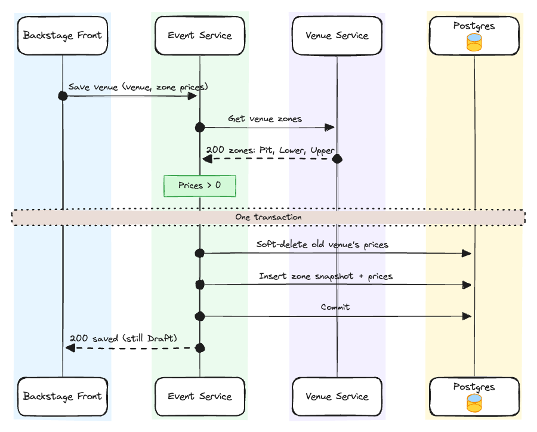\[Select venue and price its zones\]](diagrams/c2-select-venue-and-price.png)

[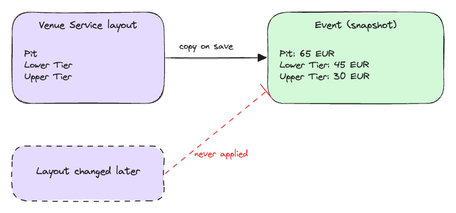\[Zone snapshot\]](diagrams/c2-zone-snapshot.png)

Event Service reads the zones from Venue Service when the venue is saved and copies them into the event with their prices. A draft can be saved with missing prices; the check that every zone is priced happens when the event is scheduled (C4).

**Edge cases:**

[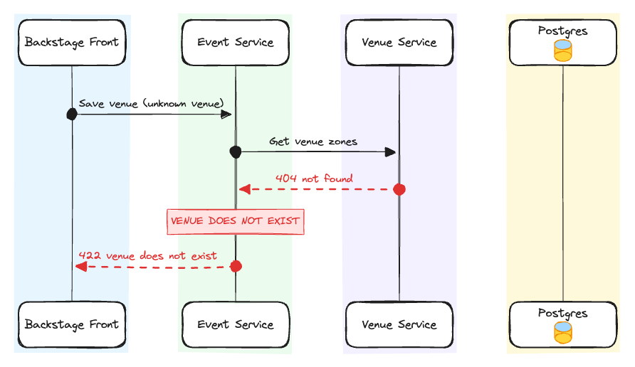\[Venue does not exist\]](diagrams/c2-edge-venue-not-found.png)

---

### C3 - Set sales window

> ***As an organizer, I decide exactly when tickets go on sale and when sales stop.***

##### Expectations:

- Dates must satisfy `now < sale_starts_at < sale_ends_at <= event_starts_at`, validated against server time, never client time.
- `sale_starts_at` is the single anchor for the event lifecycle: it defines when the event locks (C5) and when it propagates (C6). Moving it moves both.

**ADRs:** \[links\]

##### Diagrams:

[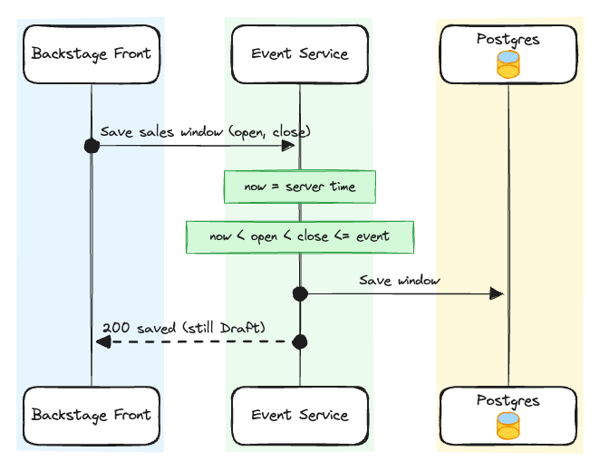\[Save the sales window\]](diagrams/c3-save-sales-window.png)

[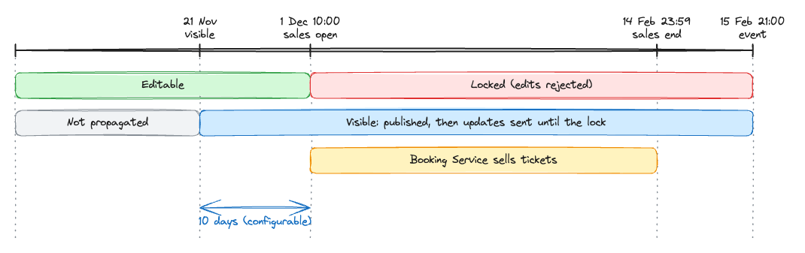\[Event lifecycle timeline\]](diagrams/c3-lifecycle-timeline.png)

**Edge cases:**

[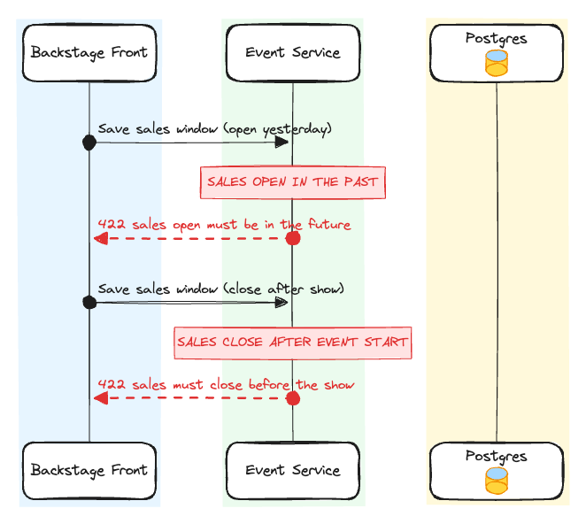\[Sales window breaks the date order\]](diagrams/c3-edge-invalid-window.png)

---

### C4 - Schedule the event

> ***As an organizer, I click Save when every step is ready, and the event is scheduled only if all of them are valid.***

##### Expectations:

- When the organizer clicks Save, the event moves from `Draft` to `Scheduled` only if the name, all zone prices, the sales window and the show details are valid.
- Every zone of the selected venue must have a price greater than 0; an event with an unpriced zone stays in `Draft`.
- The sales window is checked again at Save against server time, since `now` may have passed `sale_starts_at` after the window was saved.

**ADRs:** \[links\]

##### Diagrams:

[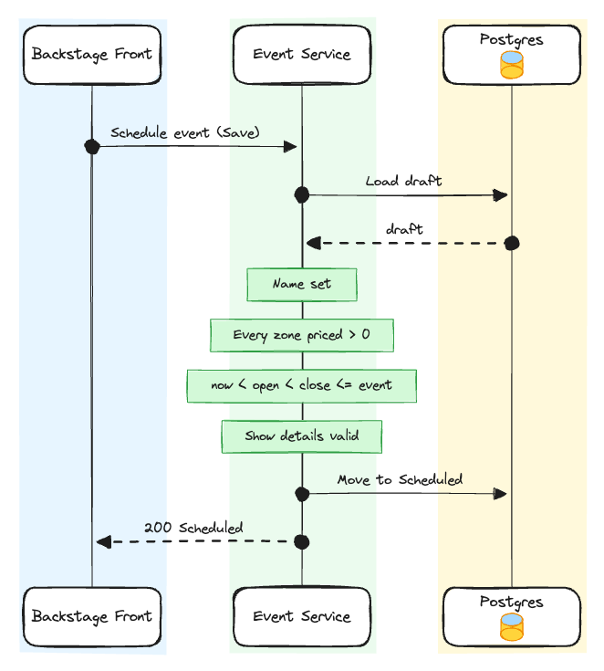\[Schedule the event\]](diagrams/c4-schedule-event.png)

**Edge cases:**

[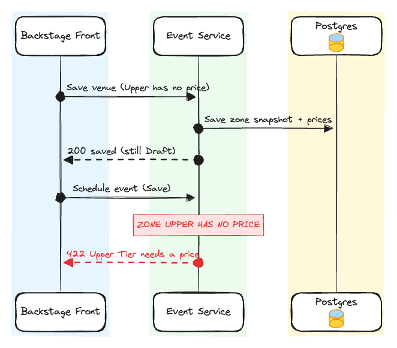\[Scheduling with an unpriced zone\]](diagrams/c4-edge-unpriced-zone.png)

[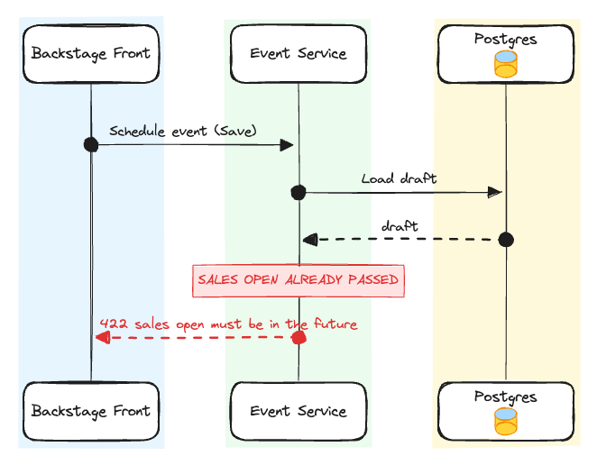\[Sales open passed before Save\]](diagrams/c4-edge-window-expired.png)

---

### C5 - Lock event after sale window opens

> ***As an organizer, I can edit my event freely until sales open; as a buyer, what I see when I buy is what I get.***

##### Expectations:

- Any modification to an event where `now >= sale_starts_at` fails with `409: Event Locked`, regardless of the client.
- Lock check and write happen in the same transaction (conditional update on `sale_starts_at > now()`), so an edit racing the sale opening can never slip through.

**ADRs:** [ADR-002](adrs-event-propagation.md#adr-002---use-the-database-clock-for-the-lock-and-timestamptz-for-all-times)

##### Diagrams:

[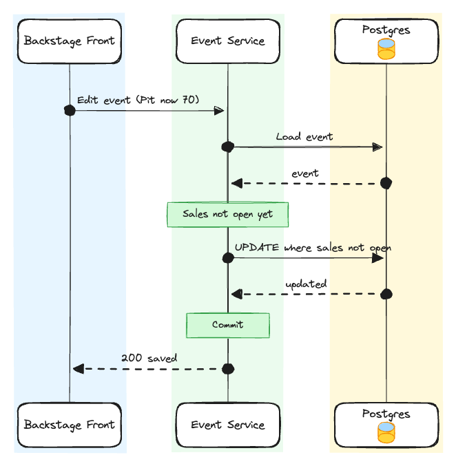\[Edit before sales open\]](diagrams/c5-edit-before-lock.png)

**Edge cases:**

[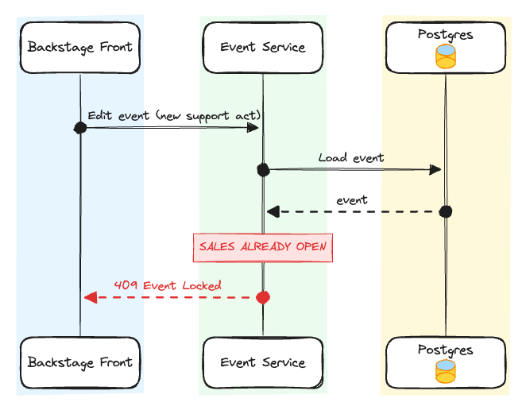\[Edit after sales open\]](diagrams/c5-edge-edit-after-lock.png)

[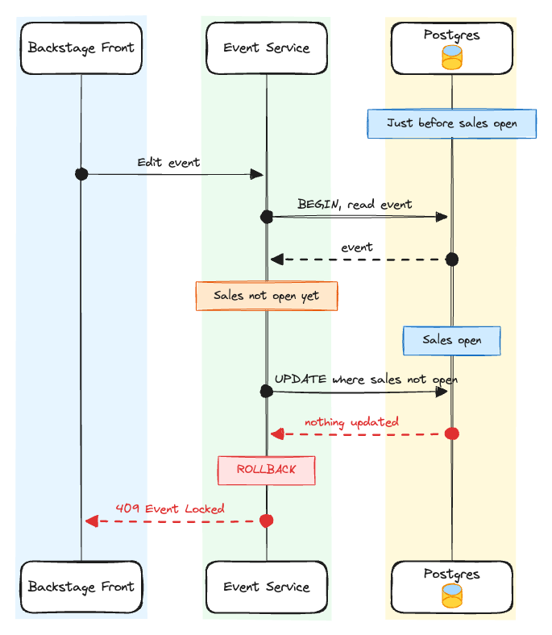\[Edit racing the sale opening\]](diagrams/c5-edge-race-with-sale-opening.png)

In the race above the application check passes, but the database clock has already crossed `sale_starts_at` when the `UPDATE` runs. The `WHERE sale_starts_at > now()` condition matches 0 rows, the transaction rolls back and the organizer gets `409`.

---

### C6 - Event propagation to other services

> ***As a buyer, I can discover an event 10 days before it goes on sale; as other services, we receive the event once it is ready to be public.***

##### Expectations:

- The 10-day lead time should be configurable at service level through `EVENT_VISIBILITY_LEAD_DAYS`.
- At `sale_starts_at - EVENT_VISIBILITY_LEAD_DAYS`, Event Service publishes an `EventPublished` event through its outbox.
- Drafts are never propagated, and `Scheduled` events are never propagated before their visibility moment.
- If the event is scheduled when its visibility moment is already past (sale opens in less than N days), it is propagated immediately.
- Edits between propagation and the lock emit an `EventUpdated` event carrying the event version; consumers discard any version older than or equal to the one they have.
- Every accepted edit increments the event's `version` in the same update that saves it.
- Every `EventPublished` and `EventUpdated` message carries the full event (show details, zone prices and sales window) and its version.
- Whether an edit emits `EventUpdated` depends on `published_at` as returned by the edit's own update, so an edit racing the scheduled job is never left unpublished.
- A scheduled job in Event Service finds events that reached their visibility moment and publishes them.
- Events are published to the Kafka topic `events.lifecycle`, keyed by event id, so all messages for one event keep their order.
- Booking Service and Search Service subscribe to `events.lifecycle` with their own consumer groups, `booking-service` and `search-service`.

**ADRs:** [ADR-003](adrs-event-propagation.md#adr-003---publish-events-with-a-scheduled-job-at-the-visibility-moment), [ADR-004](adrs-event-propagation.md#adr-004---integer-event-version-and-full-state-messages)

##### Diagrams:

[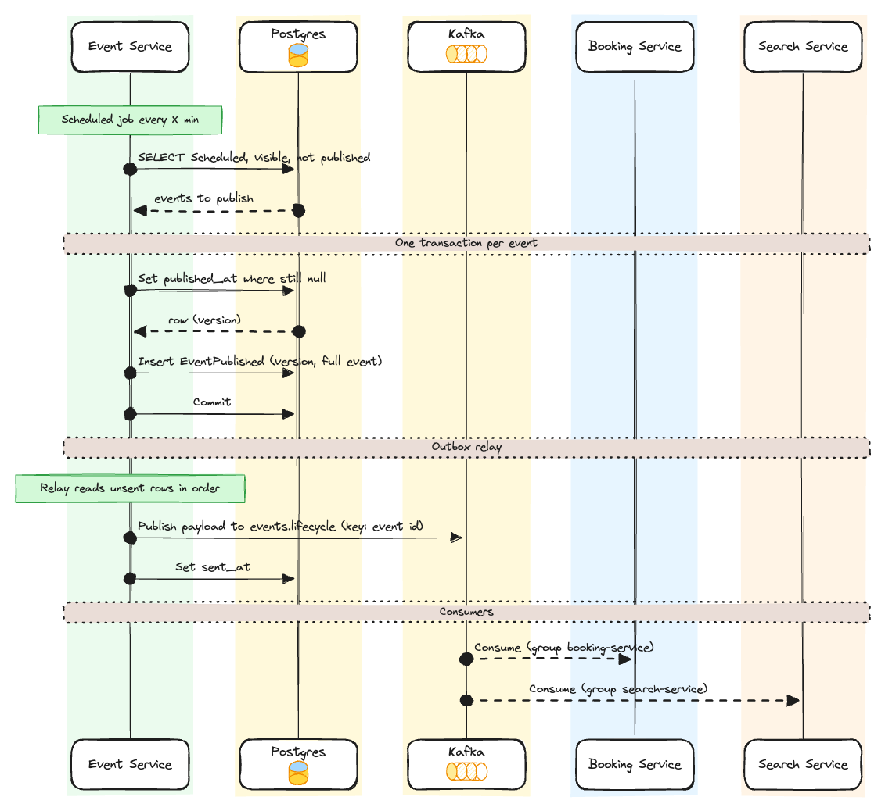\[Publish at the visibility moment through the outbox\]](diagrams/c6-publish-at-visibility.png)

Every X minutes, the scheduled job selects `Scheduled` events whose visibility moment has passed and that are not published yet. In one transaction it marks each one as published and puts `EventPublished` in the outbox. The relay then publishes the outbox rows to `events.lifecycle`, the same way Booking Service does for `ticketsold`.

[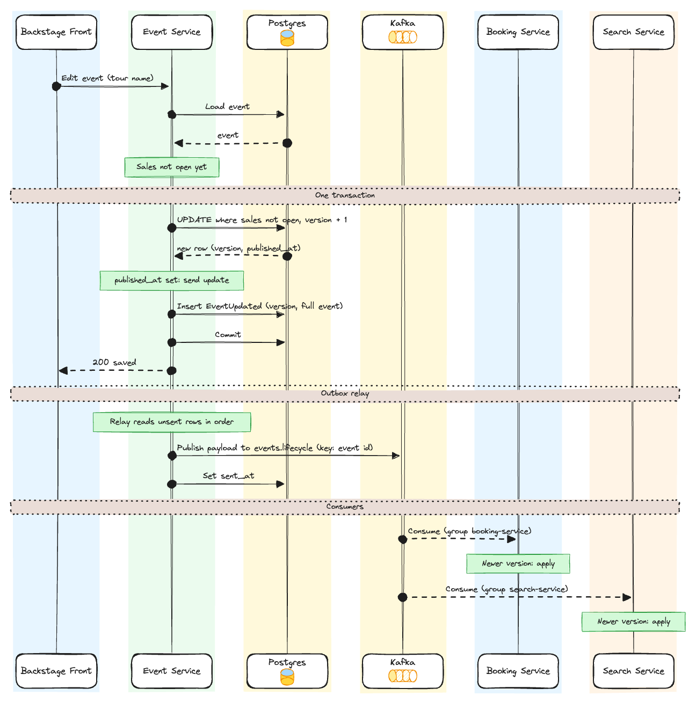\[Edit after propagation emits EventUpdated\]](diagrams/c6-event-updated.png)

**Edge cases:**

[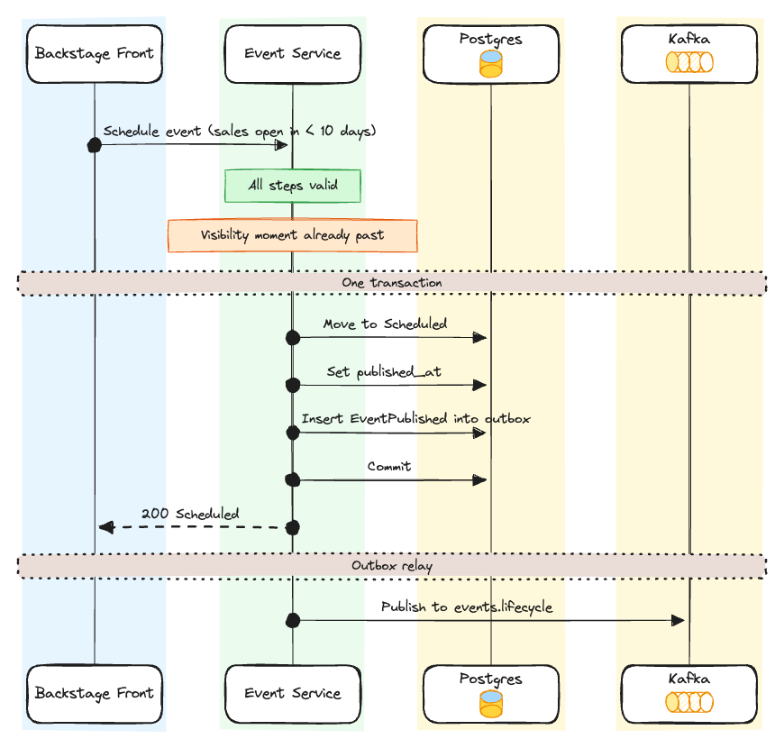\[Visibility moment already past when scheduling\]](diagrams/c6-edge-publish-immediately.png)

[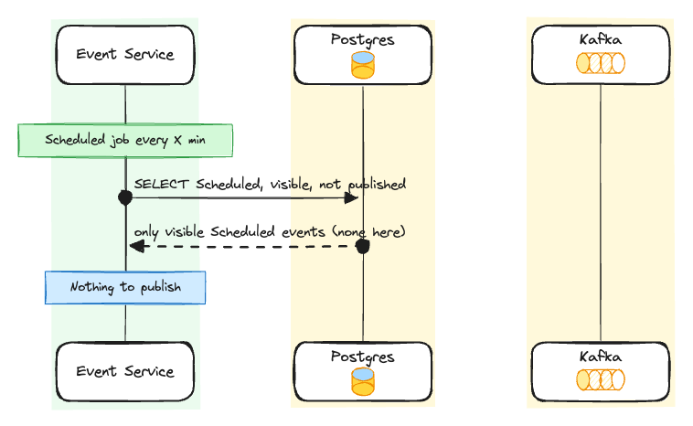\[Drafts and early events are never propagated\]](diagrams/c6-edge-draft-or-early-not-published.png)

[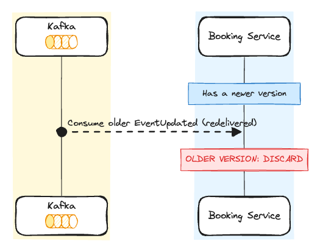\[Consumer receives an older or repeated version\]](diagrams/c6-edge-stale-version.png)
